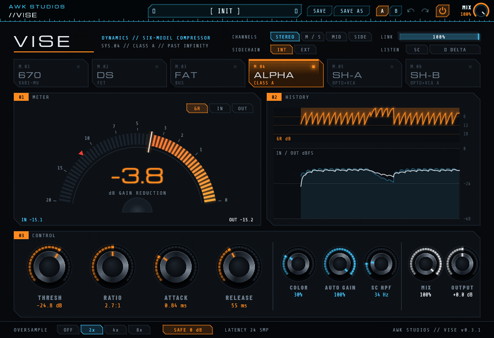

# VISE

**Six compressor models in one box, with external sidechain, M/S and delta listening.**



VISE has six compressor models: a vari-mu tube unit, a fast FET, a bus compressor, a class-A unit and two opto + VCA designs. Each model has its own knob set, and the labels change with the model. A 200° LED arc meter shows gain reduction, input or output.

## Features

- **Models:** 670 (vari-mu), DS (FET, up to NUKE), FAT (bus), ALPHA (class A), SH-A and SH-B (opto + VCA).
- **COLOR** stage (oversampled), **AUTO GAIN** and a sidechain high-pass on every model.
- **External sidechain** (INT / EXT): duck a bass from the kick, make room for a vocal.
- **STEREO / M-S / MID / SIDE** processing, plus a **LINK** fader from fully linked to fully independent channels.
- **LISTEN:** SC (hear what the detector hears) or Δ DELTA (hear only what's being taken out).
- MIX against a delay-matched dry, OUTPUT, and SAFE (never over 0 dBFS).
- 26 factory presets.

## Install

Windows 64-bit, VST3. Built and tested in FL Studio.

1. Download `Vise-v0.3.2-win64.zip` from [Releases](../../releases/latest).
2. Copy `Vise.vst3` into `C:\Program Files\Common Files\VST3\`.
3. Copy the files in `presets` into `Documents\Awknode\Presets\Vise\` (create the folder if it doesn't exist).
4. Rescan plugins in your DAW.

## Using it

Every awk studios plugin has the same top strip: preset browser, A/B, undo/redo, power (bypass) and a global MIX. Knobs drag up and down (hold Ctrl or Shift for fine control), scroll to nudge, and double-click to reset. **SAFE** in the footer is an output limiter that keeps the plugin from going over 0 dBFS; it's on by default.

The full control reference is in the **[manual](docs/MANUAL.md)**.

## Build from source

You'll need Docker. Clone this repo next to the [nice-plug-awk](https://github.com/awknode/nice-plug-awk) framework fork, then run the build script:

```sh
git clone https://github.com/awknode/vise
git clone -b awk-studios https://github.com/awknode/nice-plug-awk
cd vise && ./build.sh
```

The plugin lands in `target/bundled/Vise.vst3`.

## License

GPL-3.0. See [LICENSE](LICENSE). Built with [nice-plug](https://codeberg.org/RustAudio/nice-plug).

---

More awk studios plugins: [SALVE](https://github.com/awknode/salve) · [HOIST](https://github.com/awknode/hoist) · [KILN](https://github.com/awknode/kiln) · [PATINA](https://github.com/awknode/patina) · [CHOPSHOP](https://github.com/awknode/chopshop) · [THROWBACK](https://github.com/awknode/throwback) · [THROW FX](https://github.com/awknode/throw-fx) · [KICKNULL](https://github.com/awknode/kicknull) · [ALLEYVERB](https://github.com/awknode/alleyverb) · [WAVETAG](https://github.com/awknode/wavetag) · [dBCOMP](https://github.com/awknode/dbcomp) · [dBVOX](https://github.com/awknode/dbvox)
